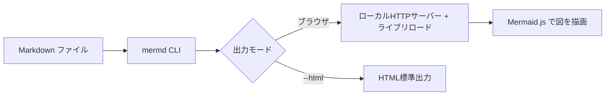
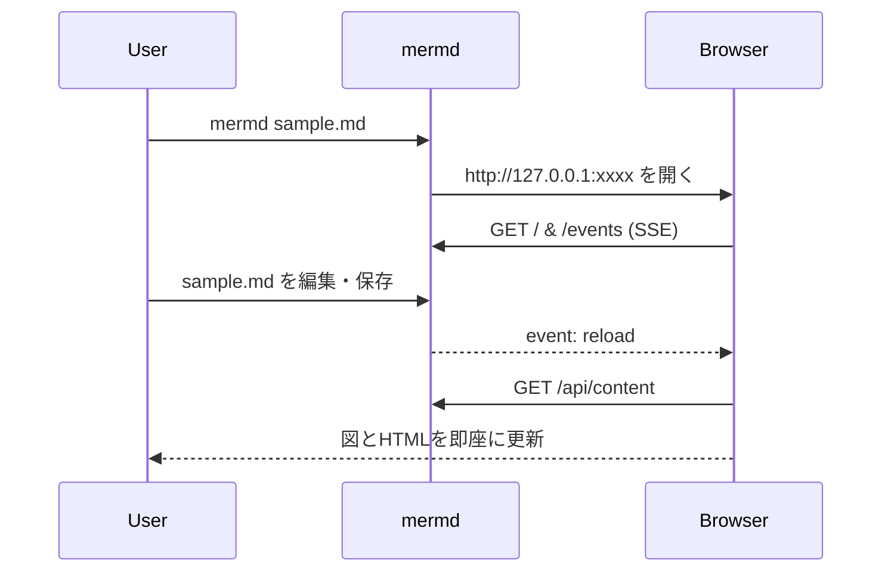

# mermd サンプルドキュメント

`mermd` は Markdown を HTML ライクに表示しつつ、**Mermaid** ダイアグラムを正しく描画するための CLI プレビューアです。

## 1. フローチャート (Flowchart)

## 2. シーケンス図 (Sequence Diagram)

## 3. GFM テーブル & タスクリスト

| 機能 | ステータス | 備考 |
| --- | --- | --- |
| GFM テーブル | 対応済み | `goldmark` 使用 |
| Mermaid 描画 | 対応済み | Light / Dark テーマ追従 |
| ライブリロード | 対応済み | SSE で差分更新 |

- [x] CLI 引数・標準入力対応
- [x] ダークモード切り替え
- [ ] お好みで機能追加
